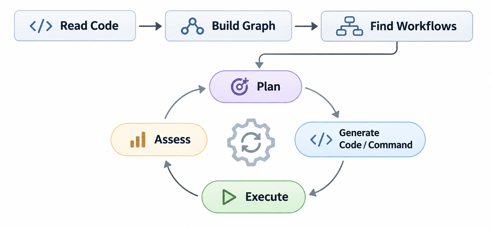

# Deeplyzer

### Deep analysis of software beyond static code analysis.

## The Problem

Software failures are rarely limited to bugs in source code.

An application can fail for thousands of reasons across its code, infrastructure, dependencies, and runtime environment.

Consider a few examples:

- **Configuration issues:** Missing environment variables, incorrect configurations, invalid credentials.
- **Network issues:** Connectivity failures, DNS resolution, firewall restrictions, API timeouts.
- **Database issues:** Invalid schemas, unexpected data formats, missing tables, permission issues, connection failures.
- **Infrastructure issues:** Misconfigured cloud resources, insufficient permissions, resource limits, incorrect deployment configurations.
- **Workflow issues:** Broken execution paths, unexpected dependencies, incorrect assumptions between components.
- **Integration issues:** Incompatible API responses, third-party service failures, version mismatches.
- **Runtime issues:** Memory exhaustion, concurrency problems, unhandled exceptions, resource leaks.

The possibilities run into thousands.

This makes traditional validation approaches insufficient. It is practically impossible to anticipate every failure scenario and build a fixed set of algorithms or rules to validate them all.

## The Solution: Deeplyzer

Deeplyzer takes a fundamentally different approach to software analysis.

Instead of relying on predefined validation rules, it understands the application, discovers its dependencies, maps its workflows, and autonomously investigates potential failure scenarios.

### How It Works

1. **Builds Code Graphs**

   Analyzes source code and creates semantic graphs representing classes, functions, variables, dependencies, and relationships across the codebase.

2. **Understands Application Workflows**

   Connects the graphs to discover how different components interact and maps end-to-end execution workflows.

3. **Analyzes Infrastructure**

   Discovers and understands the underlying infrastructure, including cloud resources, configurations, permissions, databases, and external dependencies.

4. **Plans Validations Autonomously**

   Uses its understanding of the application and infrastructure to identify potential failure scenarios and formulate targeted validation plans.

5. **Generates Executable Checks**

   Generates the necessary code, scripts, and commands to investigate the identified scenarios.

6. **Executes and Evaluates**

   Executes the generated checks, evaluates the results, and determines whether the application and its underlying infrastructure behave as expected.

## Beyond Static Code Analysis

Traditional static analysis examines code against predefined rules and known patterns.

Deeplyzer goes further. It understands how the application works, investigates the environment it depends on, and actively validates whether the entire system can operate as expected.

**Deeplyzer doesn't just analyze code. It investigates how software can fail.**

## How Deeplyzer Works



## Installation

Install Deeplyzer using npm:

```bash
npm install deeplyzer
```

## Configuration

Create a configuration file (e.g. `deeplyzer.json`) in your project root.

```json
{
  "sources": [],
  "source_exclusions": [],
  "llm": {
    "provider": "openai | gemini | claude",
    "model": "gpt-6.1-sol",
    "apiKey": "<API key goes here>"
  },
  "log_path": "C:\\deeplyzer\\.logs",  
  "build_graph": false,
  "deep_analysis": true,
  "static_analysis": false,
  "batch_size": 10
}
```

### Configuration Options

| Option | Required | Default | Description |
|---|---|---|---|
| `sources` | Yes | `[]` | Source files or directories to analyze. |
| `source_exclusions` | No | `[]` | Files or directories to exclude from analysis. |
| `llm.provider` | Yes | - | LLM provider (`openai`, `claude`, `gemini`). |
| `llm.model` | Yes | - | Model to use for analysis. |
| `llm.apiKey` | Yes | - | API key for the selected LLM provider. |
| `build_graph` | No | `true` | Build semantic code graphs. |
| `deep_analysis` | No | true | Enable deep LLM-based analysis. |
| `static_analysis` | No | `true` | Enable static code analysis. |
| `batch_size` | No | `10` | Number of sources processed in each batch. |
| `log_path` | No | - | Directory where analysis logs are written. |

**Note:** `build_graph`, `static_analysis`, and `batch_size` are optional. If omitted, their default values are used.

## Links

- **GitHub Repository:** [github.com/areteqa/deeplyzer](https://github.com/areteqa/deeplyzer)
- **NPM Package:** [npmjs.com/package/deeplyzer](https://www.npmjs.com/package/deeplyzer)

## License

Deeplyzer is open-source software licensed under the [MIT License](LICENSE).

You are free to use, modify, distribute, and use it commercially, subject to the terms of the license.